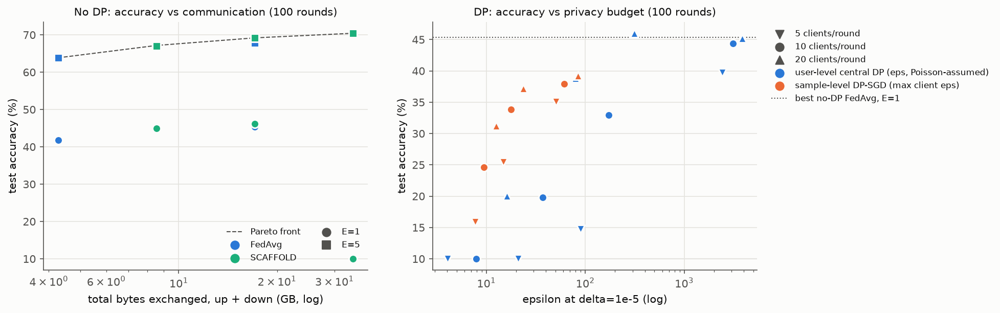
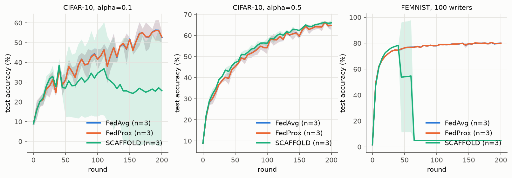
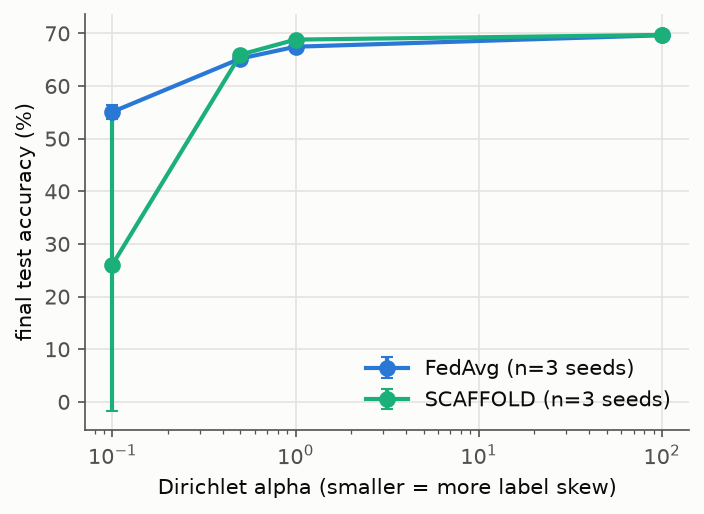

# fedlab-repro

[](https://github.com/amirhosseinkho/fedlab-repro/actions/workflows/ci.yml)

A reproduction of FedAvg, FedProx and SCAFFOLD under non-IID data on
[Flower](https://flower.ai) 1.41, and a small study of the three-way trade-off
between accuracy, communication (bytes on the wire) and differential privacy
(epsilon). Everything runs on one laptop GPU (GTX 1650 Ti, 4 GB). FedAvg and
FedProx behave as their papers describe; SCAFFOLD beats FedAvg by up to 1.4
points at moderate label skew but **diverged** in 6 of the 27 SCAFFOLD runs
(strong label skew, FEMNIST, and one E3 setting) at the shared learning rate
used here. In the trade-off study, more local epochs is by far the cheapest way
to buy accuracy per byte, SCAFFOLD's doubled messages pay off only at the
largest byte budgets, and with 20 clients per round user-level central DP costs
nothing at epsilon about 300 but 25 points at epsilon 16.
Every number in this README comes from a run log in `results/`.



*E3, CIFAR-10 with Dirichlet alpha = 0.5, 100 clients, 100 rounds. Left: no
DP; squares use 5 local epochs, circles 1. Right: user-level central DP
(blue, epsilon under Poisson-assumed accounting, see below) and sample-level
DP-SGD (orange, largest epsilon of any client); marker shape is the number of
clients per round. Points at 10% are runs whose loss became NaN.*

## Results

All accuracies are on the held-out test set, averaged over the last three
evaluations (every 5 rounds), in %, as mean ± standard deviation over seeds.
"Diverged" means the training loss became NaN and the model then predicts a
single class; those seeds are included in the mean.

### E1: reproduction, 200 rounds

CIFAR-10 with Dirichlet label skew, 100 clients, 10 per round, E = 2, B = 50,
lr 0.03. FEMNIST (LEAF writers, `flwrlabs/femnist`), 100 writers, 10 per
round, E = 2, B = 20, lr 0.05. FedProx mu = 0.01.

| dataset | partition | FedAvg | FedProx | SCAFFOLD | seeds |
|---|---|---|---|---|---|
| CIFAR-10 | Dirichlet alpha=0.1 | 55.1 ± 1.4 | 55.0 ± 1.4 | 26.1 ± 27.8 (2 of 3 diverged) | 3 |
| CIFAR-10 | Dirichlet alpha=0.5 | 65.2 ± 1.1 | 65.2 ± 1.0 | 66.0 ± 0.7 | 3 |
| FEMNIST | 100 writers | 79.8 ± 0.4 | 79.8 ± 0.4 | 4.8 ± 0.0 (3 of 3 diverged) | 3 |



Before diverging, SCAFFOLD tracked FedAvg: on FEMNIST its three seeds peaked at
79.8, 79.7 and 78.4% (rounds 60, 55, 40) and became NaN at rounds 65, 65 and
45; on CIFAR-10 alpha = 0.1 the two diverging seeds peaked at 48.7 and 34.3%
and the third ended at 58.2% (FedAvg's seeds: 56.4, 53.6, 55.3).

**Comparison with the papers.** None of the three papers used this exact
setting, so the table lists each paper's closest claim next to our closest
run.

| paper | their setting and number | ours | agrees? |
|---|---|---|---|
| FedAvg (McMahan et al. 2017, Table 3) | CIFAR-10, IID, 100 clients, C = 0.1, E = 5, B = 50, tuned lr decay, contrast/brightness/whitening: 80% after 280 rounds, 85% after 2,000 | alpha = 100 (near IID), E = 2, constant lr 0.03, no colour augmentation: 69.6 ± 0.4 after 200 rounds | No, 10+ points lower at 200 rounds (deviations below) |
| FedAvg (same paper) | more local computation per round (larger E) reduces the rounds needed | E3a: E = 5 vs E = 1 at equal bytes: +22 to +23 points after 100 rounds | Yes |
| FedProx (Li et al. 2020) | without stragglers, FedProx with mu = 0 is FedAvg; mu is tuned over {0.001, 0.01, 0.1, 1} and helps mainly under systems heterogeneity | no stragglers, mu = 0.01 untuned: within 0.1 points of FedAvg in all three settings | Consistent |
| SCAFFOLD (Karimireddy et al. 2020, Table 5) | EMNIST, 2-layer MLP, 5 epochs, 20% of clients per round, lr tuned per algorithm, best accuracy in 1k rounds: FedAvg 0.787 / SCAFFOLD 0.801 (0% similarity), 0.828 / 0.842 (10%) | CIFAR-10 CNN, shared lr: +0.7 (alpha = 0.5), +1.4 (alpha = 1), +0.1 (alpha = 100); diverged at alpha = 0.1 and on FEMNIST | Partly: same sign and size where stable; not stable under strong skew |

### E2: sensitivity to label skew (CIFAR-10, 200 rounds)

alpha = 0.1 and 0.5 are the E1 runs; alpha = 1 and 100 use the same settings.

| alpha | FedAvg | SCAFFOLD | SCAFFOLD - FedAvg | seeds |
|---|---|---|---|---|
| 0.1 | 55.1 ± 1.4 | 26.1 ± 27.8 (2 of 3 diverged) | -29.0 | 3 |
| 0.5 | 65.2 ± 1.1 | 66.0 ± 0.7 | +0.7 | 3 |
| 1 | 67.5 ± 1.0 | 68.8 ± 0.5 | +1.4 | 3 |
| 100 | 69.6 ± 0.4 | 69.7 ± 0.3 | +0.1 | 3 |



FedAvg loses 14.5 points from near-IID (alpha = 100) to alpha = 0.1. SCAFFOLD's
gain is largest at moderate skew and vanishes near IID, as its analysis
predicts (the correction term is zero when all clients share one gradient).

### E3: accuracy vs bytes vs epsilon (CIFAR-10, alpha = 0.5, 100 rounds)

Seed 0 was run for every grid point; seeds 1 and 2 were added only for the
points on the three Pareto fronts of the seed-0 runs (`run_e3.py --front`).
Rows with one seed have no standard deviation. To fit the GPU budget, FedProx
was left out of E3 (it sends the same bytes as FedAvg and matched it in E1) and
the central-DP grid is z in {0, 0.1, 0.3, 0.5, 1.0} instead of
{0, 0.5, 1.0, 1.5} plus extra points.

**E3a. Communication, no DP.** Bytes are counted exactly: uplink plus
downlink, all rounds, 4 bytes per float32 parameter.

| algorithm | E | clients/round | accuracy | total MB | MB to 40% | MB to 50% | seeds |
|---|---|---|---|---|---|---|---|
| FedAvg | 1 | 5 | 41.8 | 4,273 | 3,846 | not reached | 1 |
| FedAvg | 1 | 10 | 44.7 | 8,546 | 5,128 | not reached | 1 |
| FedAvg | 1 | 20 | 45.4 | 17,093 | 8,546 | not reached | 1 |
| FedAvg | 5 | 5 | 63.9 ± 1.0 | 4,273 | 783 | 1,638 | 3 |
| FedAvg | 5 | 10 | 67.2 | 8,546 | 855 | 2,564 | 1 |
| FedAvg | 5 | 20 | 67.9 | 17,093 | 2,564 | 4,273 | 1 |
| SCAFFOLD | 1 | 5 | 45.0 | 8,546 | 5,555 | not reached | 1 |
| SCAFFOLD | 1 | 10 | 46.1 | 17,093 | 8,546 | not reached | 1 |
| SCAFFOLD | 1 | 20 | 10.0 (diverged) | 34,186 | 18,802 | not reached | 1 |
| SCAFFOLD | 5 | 5 | 67.0 ± 0.8 | 8,546 | 1,567 | 2,849 | 3 |
| SCAFFOLD | 5 | 10 | 69.2 ± 0.3 | 17,093 | 2,564 | 4,843 | 3 |
| SCAFFOLD | 5 | 20 | 70.4 ± 0.5 | 34,186 | 4,558 | 7,977 | 3 |

**E3b. User-level central DP** (DP-FedAvg, FedAvg with E = 1, clip C = 0.3,
delta = 1e-5).

| clients/round | noise z | accuracy | epsilon, no amplification | epsilon, Poisson-assumed | seeds |
|---|---|---|---|---|---|
| 5 | 0 | 40.4 | inf | inf | 1 |
| 5 | 0.1 | 39.7 | 5,612 | 2,416 | 1 |
| 5 | 0.3 | 14.8 | 721.5 | 89.8 | 1 |
| 5 | 0.5 | 10.0 (diverged) | 294.9 | 21.0 | 1 |
| 5 | 1 | 10.0 ± 0.0 (3 of 3 diverged) | 96.1 | 4.0 | 3 |
| 10 | 0 | 43.5 | inf | inf | 1 |
| 10 | 0.1 | 44.4 | 5,612 | 3,124 | 1 |
| 10 | 0.3 | 32.9 | 721.5 | 171.5 | 1 |
| 10 | 0.5 | 19.8 | 294.9 | 37.0 | 1 |
| 10 | 1 | 10.0 (diverged) | 96.1 | 7.9 | 1 |
| 20 | 0 | 44.7 | inf | inf | 1 |
| 20 | 0.1 | 45.2 | 5,612 | 3,860 | 1 |
| 20 | 0.3 | 46.0 ± 0.5 | 721.5 | 312.1 | 3 |
| 20 | 0.5 | 38.8 ± 0.7 | 294.9 | 79.8 | 3 |
| 20 | 1 | 20.1 ± 1.3 | 96.1 | 16.1 | 3 |

**E3c. Sample-level DP** (DP-SGD in every client, FedAvg with E = 1,
per-sample clip 1.0, lr 0.3, delta = 1e-5; epsilon is per client).

| clients/round | noise sigma | accuracy | max client epsilon | mean client epsilon | seeds |
|---|---|---|---|---|---|
| 5 | 0.5 | 35.1 | 50.9 | 25.7 | 1 |
| 5 | 1 | 25.4 | 14.9 | 6.0 | 1 |
| 5 | 1.5 | 15.9 ± 2.1 | 7.7 | 3.0 | 3 |
| 10 | 0.5 | 37.9 ± 1.3 | 61.5 | 35.6 | 3 |
| 10 | 1 | 33.8 ± 1.1 | 17.7 | 8.2 | 3 |
| 10 | 1.5 | 24.6 ± 0.7 | 9.4 | 4.1 | 3 |
| 20 | 0.5 | 39.3 ± 1.3 | 84.9 | 51.0 | 3 |
| 20 | 1 | 37.2 ± 1.3 | 23.7 | 11.5 | 3 |
| 20 | 1.5 | 31.3 ± 1.4 | 12.6 | 5.8 | 3 |

**Q1. When does SCAFFOLD's doubled communication pay off in accuracy per
byte?** Only at the largest budgets. SCAFFOLD sends a control variate of the
model's size in each direction, so it costs exactly twice FedAvg's bytes per
client and round. Compared at equal total bytes (SCAFFOLD with half as many
clients per round): at 8.5 GB the two are tied (E = 5: 67.0 ± 0.8 vs 67.2;
E = 1: 45.0 vs 44.7); at 17 GB SCAFFOLD is ahead (E = 5: 69.2 ± 0.3 vs 67.9;
E = 1: 46.1 vs 45.4), where the FedAvg side has one seed. To reach 50% the
cheapest run is FedAvg with E = 5 and 5 clients (1,638 MB); SCAFFOLD's cheapest
needs 2,849 MB. At alpha = 0.5 the drift SCAFFOLD corrects is small (E2: +0.7
points at equal rounds), so the doubled messages rarely pay for themselves.

**Q2. How much accuracy does each unit of epsilon cost?** The two columns
measure different things and are not directly comparable: central DP protects
everything one client holds (user-level), DP-SGD protects one training example
(sample-level). Central DP at 20 clients per round (no-DP accuracy 44.7): no
loss at epsilon 312 (z = 0.3), -5.9 points at epsilon 80 (z = 0.5), -24.6 at
epsilon 16 (z = 1). DP-SGD at 20 clients per round, against the same 44.7:
-5.4 points at epsilon 85, -7.5 at 24, -13.4 at 12.6. So below epsilon of
about 50 a sample-level guarantee is much cheaper than a user-level one in this
setting, at the price of a weaker unit of protection. Central DP also depends
strongly on the number of clients per round: the noise is added to an average
over m clients, so at z = 0.5 accuracy goes from diverged (m = 5) to 19.8
(m = 10) to 38.8 (m = 20), while the Poisson-assumed epsilon grows only from 21
to 80.

**Q3. Which knob is cheapest to turn?** Local epochs. Going from E = 1 to
E = 5 costs no bytes (only client computation) and adds 22 to 23 points
(FedAvg: 41.8 to 63.9 at 5 clients per round). Doubling the clients per round
doubles the bytes and adds 0.7 to 3.3 points. Switching to SCAFFOLD at the
same clients per round also doubles the bytes and adds 1.4 to 3.2 points
(stable runs only); at equal bytes it adds 0 to 1.3 (Q1). Under central DP the
number of clients per round matters most (Q2).

## Reproduce in 3 commands

```bash
pip install -r requirements.txt && pip install -e . --no-deps
python experiments/prepare_data.py mnist
python experiments/run_e1.py --quick && python experiments/aggregate.py --quick
```

`--quick` replaces CIFAR-10/FEMNIST with 12,000 MNIST images, 10 clients, a
few rounds on the CPU (under 3 minutes per experiment); its numbers are smoke
tests. The full experiments need `prepare_data.py cifar10 femnist` and then
`python experiments/run_e1.py`, `run_e2.py`,
`run_e3.py` and `run_e3.py --front`, then `aggregate.py` and `plots.py`
(about 10 GPU-hours on a GTX 1650 Ti). Every script takes `--seed`,
`--out-dir` and `--quick`; runs that already have a result file are skipped.
`requirements.txt` pins the CUDA 12.8 build of PyTorch; CI installs the CPU
build. Datasets are cached under `$FEDLAB_DATA` (default `data/`).

## Design notes

### Why Flower, and what was written here
Flower separates the server logic (`ServerApp` and `Strategy`) from the client
logic (`ClientApp`); they exchange typed `Message`s carrying `ArrayRecord`s.
FedAvg, FedProx and the central-DP wrapper are Flower's own strategies
(flwr 1.41.0); only SCAFFOLD, the client training and the transport were
written here.

Flower's simulation engine needs Ray, which flwr 1.41.0 does not install on
Windows with Python 3.13. The repo therefore implements Flower's abstract
`Grid` (the transport a `ServerApp` talks to) as an in-process, sequential
`SequentialGrid` (`src/fedlab/grid.py`). Everything above the transport is
Flower's code: `ServerApp`, `Strategy.start`, node sampling, aggregation and
`ClientApp` dispatch. Messages are deep-copied in both directions and every
node keeps a persistent `Context`, as a SuperNode would.

### SCAFFOLD
`src/fedlab/strategies/scaffold.py` subclasses Flower's `FedAvg` and adds the
server control variate `c` to every training message. The client keeps its own
`c_i` in `context.state`, adds `c - c_i` to every local gradient and returns
the new weights plus `delta c_i` (option II of Algorithm 1). A unit test runs
two rounds on a linear model and compares the weights and both control
variates with Algorithm 1 computed by hand. One deviation: the server weights
clients by data size (see Deviations).

### Two DP levels and what each epsilon means
| | sample-level DP | user-level central DP |
|---|---|---|
| protects | one training example of one client | all data of one client |
| mechanism | DP-SGD in each client (Opacus: per-sample clipping to 1.0, Gaussian noise, Poisson sampling) | DP-FedAvg: the server clips each client update to 0.3 and adds Gaussian noise to the average (Flower `DifferentialPrivacyServerSideFixedClipping`) |
| trusts the server | no | yes (it sees unclipped updates) |
| epsilon | per client, Opacus RDP accountant over every round the client took part in; max and mean over clients | Flower's `RdpAccountant` (Google's dp-accounting) over all rounds |
| delta | 1e-5 | 1e-5 |

Two central epsilons are reported. *No amplification* treats every round as a
Gaussian mechanism on the whole population; Flower 1.41's in-strategy
accountant only allows this mode, and it is a valid bound for these runs.
*Poisson-assumed* is the subsampled-Gaussian accounting of the DP-FedAvg paper
with q = m/N. It assumes each client joins a round independently with
probability q; this simulation samples exactly m clients without replacement
(Flower's `sample_nodes`), so the Poisson number is **not** a formal guarantee
for these runs and is shown only for comparison with the literature. Client
weights are equal in DP runs (the sensitivity argument needs a fixed
denominator) and federated evaluation is off, so no unaccounted metric leaves
a client. No epsilon is computed by hand.

### How bytes are counted
`src/fedlab/comm.py` inspects every `Message` that crosses the grid and sums,
for each array in each `ArrayRecord`, `prod(shape) * itemsize` read from the
array's own dtype and shape: uplink and downlink separately, per round.
SCAFFOLD's messages carry two `ArrayRecord`s (model and control variate) in
each direction, so it costs exactly twice FedAvg's bytes. Flower's serialised
size (`ArrayRecord.count_bytes()`, which adds headers and key strings) is
logged too. Scalars in config and metric records are not counted.

## Deviations from the papers

All decisions, with the pilot runs behind them, are in
[docs/decisions.md](docs/decisions.md).

* **Learning rate.** One constant lr per dataset for all algorithms, no decay,
  no momentum: 0.03 on CIFAR-10 and 0.05 on FEMNIST (D15, D19). The papers
  tune the lr per algorithm (SCAFFOLD, FedProx) or tune a decay schedule
  (FedAvg). 0.03 is the largest value at which SCAFFOLD stayed stable in a
  60-round pilot; FedAvg's best pilot lr was 0.1, so FedAvg runs below its best
  lr. The pilot did not predict the later divergences reported above.
* **Local steps.** Clients run E epochs with batch size B, so the number of
  local steps grows with client size (from 2 to 88 steps per round on CIFAR-10
  alpha = 0.1). The SCAFFOLD paper fixes 5 steps per epoch for every client.
  This is the likeliest cause of SCAFFOLD's divergence: its step-size bound
  scales as 1/K, so the client with the most steps sets the limit.
* **SCAFFOLD aggregation** is weighted by client size for both the model and
  the control variate, instead of Algorithm 1's equal weights (D12). With
  equal client sizes the two are identical (unit test). In a pilot the
  unweighted version ended below FedAvg (33.7 vs 37.1%).
* **FedAvg on CIFAR-10.** No contrast, brightness or whitening preprocessing
  (D8), PyTorch's default initialisation (D9), non-IID partitions, E = 2.
* **FedProx.** mu = 0.01 from the paper's grid, not tuned; no stragglers; the
  paper's own FEMNIST is a 10-class logistic-regression task, not LEAF's.
* **FEMNIST** is a fixed subset of 100 LEAF writers (D7), not the full 3,597.
* **DP.** Central clip C = 0.3 is about the median client update norm (D20);
  DP-SGD uses lr 0.3 because per-sample clipping shrinks the steps (D20), so
  DP-SGD and non-DP points differ in lr as well. The Poisson-assumed central
  epsilon is not a formal guarantee here (see above).
* **Final accuracy** is the mean of the last three evaluations (D24).

## Limitations and known issues

* **SCAFFOLD diverged** in 6 of its 27 runs: CIFAR-10 alpha = 0.1 (2 of 3
  seeds), FEMNIST (3 of 3), and E3 with E = 1 and 20 clients per round (1 of
  1). Its unit test passes and its update norms stay normal until one round
  explodes, which points to instability (heterogeneous local step counts, a
  shared lr) rather than a coding error; a fixed number of local steps or a
  per-algorithm lr would likely fix it but was not run.
* **Seeds.** E1 and E2 use 3 seeds; E3 uses 1 seed except for Pareto-front
  points (3 seeds), so most E3 rows have no error bar.
* **Not converged.** E3 stops at 100 rounds and E1/E2 at 200; accuracies are
  still rising, and the paper's CIFAR-10 accuracy is not reached.
* **GPU runs are not bitwise reproducible**: the CIFAR-10 model's local
  response norm has no deterministic CUDA backward (D23). The CPU path is
  (unit test).
* **Simulation, not deployment.** No gRPC, no stragglers, no client dropout;
  clients run sequentially in one process.
* **Compute.** The runs in `results/` took 12.3 GPU-hours (pilots 2.7, E1 3.2,
  E2 1.4, E3 5.0), over the 10-hour budget planned.

## Repository layout

```
src/fedlab/        data.py, models.py, clients.py, grid.py, comm.py,
                   privacy.py, runner.py, strategies/scaffold.py
configs/           e1.yaml, e2.yaml, e3.yaml
experiments/       run_e1.py, run_e2.py, run_e3.py, aggregate.py, plots.py,
                   phase_checks.py (pilots), prepare_data.py
results/           one JSON per run (config, history, bytes, epsilons),
                   summary CSVs, tables.md, logs/
figures/           the PNGs above
tests/             unit tests (pytest)
docs/decisions.md  every engineering decision and deviation
```

## References

See [references.bib](references.bib).

* H. B. McMahan, E. Moore, D. Ramage, S. Hampson, B. Agüera y Arcas.
  Communication-Efficient Learning of Deep Networks from Decentralized Data.
  AISTATS 2017.
* T. Li, A. K. Sahu, M. Zaheer, M. Sanjabi, A. Talwalkar, V. Smith.
  Federated Optimization in Heterogeneous Networks. MLSys 2020.
* S. P. Karimireddy, S. Kale, M. Mohri, S. Reddi, S. Stich, A. T. Suresh.
  SCAFFOLD: Stochastic Controlled Averaging for Federated Learning. ICML 2020.
* H. B. McMahan, D. Ramage, K. Talwar, L. Zhang. Learning Differentially
  Private Recurrent Language Models. ICLR 2018.
* M. Abadi, A. Chu, I. Goodfellow, H. B. McMahan, I. Mironov, K. Talwar,
  L. Zhang. Deep Learning with Differential Privacy. CCS 2016.
* I. Mironov. Rényi Differential Privacy. CSF 2017.
* S. Caldas et al. LEAF: A Benchmark for Federated Settings. 2018.
* T.-M. H. Hsu, H. Qi, M. Brown. Measuring the Effects of Non-Identical Data
  Distribution for Federated Visual Classification. 2019.
* D. J. Beutel et al. Flower: A Friendly Federated Learning Research
  Framework. 2020.
* A. Yousefpour et al. Opacus: User-Friendly Differential Privacy Library in
  PyTorch. 2021.

## License

MIT, see [LICENSE](LICENSE). Datasets keep their own licenses (FEMNIST via
`flwrlabs/femnist`: BSD-2-Clause).
